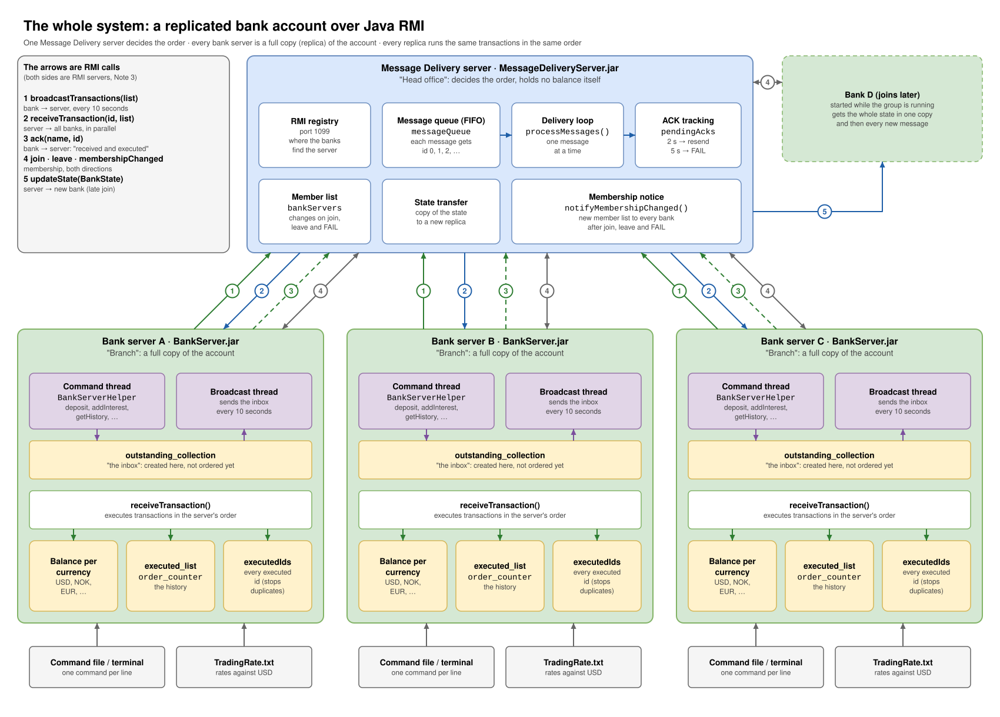

# IN5020 Assignment 2: Replicated Bank Account (Group 1)

One bank account, kept as identical copies on several bank servers (replicas). A central Message Delivery server puts every transaction in one global order and sends it to all replicas. Because every replica starts at 0 and runs the same transactions in the same order, they all end with the same balance. Everything talks over Java RMI.



*Figure 2 from our explanation document (`docs_P/IN5020_A2_forklaring.docx`, in Norwegian). The numbers on the arrows are the RMI calls listed in the box on the left. The other diagrams are in `docs_P/diagrammer/` (Norwegian) and `docs_P/diagrammer/en/` (English).*

## How it works

1. A command like `deposit NOK 100` does not change the balance right away. It becomes a transaction in the replica's `outstanding_collection`.
2. Every 10 seconds the replica sends its outstanding transactions to the server (`broadcastTransactions`, arrow 1).
3. The server gives the list a message id and puts it in a FIFO queue. It sends one message at a time to every replica in parallel (`receiveTransaction`, arrow 2).
4. Each replica executes the transactions in that order and answers with `ack` (arrow 3). The server only sends the next message once every replica has ACKed, so no replica is ever more than one message behind.
5. No ACK after 2 s: the server resends. No ACK after 5 s: the replica is marked FAIL and removed. Joins, leaves and failures are sent to everyone with `membershipChanged` (arrow 4). A replica that joins late gets a copy of the state first (`updateState`, arrow 5).

The short version: the server is a sequencer, and the replicas are a replicated state machine. The order is the only thing that has to be agreed on. Deposit and interest do not commute, so getting the same transactions in a different order gives a different balance.

## Build

Requires Java 11 or newer.

```
./scripts/build.sh        # macOS / Linux
scripts\build.bat         # Windows
```

This creates `jars/MessageDeliveryServer.jar` and `jars/BankServer.jar`.

## Run

```
java -jar jars/MessageDeliveryServer.jar [port]

java [-Dsync=correct|naive] -jar jars/BankServer.jar <server address> <account name> <number of replicas> <currency file> [command file]
```

- `server address` is `host:port`, e.g. `localhost:1099` (default port 1099).
- Each replica waits until `<number of replicas>` have joined before it starts.
- With a command file, one command is read every 0.5-1.5 s and the server exits at the end.
- `-Dsync` chooses the getSyncedBalance version (default `correct`).
- On several machines, add `-Djava.rmi.server.hostname=<own IP>` to every process.

Official scenario (3 replicas with Rep1 at 0 s, 2 with Rep2 at 7 s, 1 with Rep3 at 12 s):

```
./scripts/run_final.sh correct    # logs in output/correct/
./scripts/run_final.sh naive      # logs in output/naive/
```

## getSyncedBalance: naive vs correct

`getQuickBalance` reads the local copy straight away, so it can miss the replica's own transactions that are not ordered yet. `getSyncedBalance` should wait until they are executed.

**Naive:** wait until `outstanding_collection` is empty, then print the balance. If new transactions keep coming, the answer includes transactions issued after the request, and under steady load it can wait forever (starvation).
In `output/naive/rep3_a.txt`, getSyncedBalance at 15:36:26 got its answer 2 s later, and the answer included `deposit EUR -150`, which was issued after the request.

**Correct:** put a marker in `outstanding_collection`. It is sent and ordered like a normal transaction. When it comes back, the replica that issued it prints the balance. Other replicas ignore it, and it is not added to `executed_list`. The answer is the state exactly where the request sits in the total order, and it always comes after one broadcast round plus delivery.

Neither version blocks the command loop. That is also what makes the difference visible: new commands can arrive while the request is waiting.

## Design choices

- **Exactly once:** executed ids are kept in a set (`executedIds`) that `cleanHistory` does not clear, so duplicates from re-broadcasts and resends are skipped. The ACK is still sent.
- **Wait for N replicas at startup:** the first replicas get no state transfer, so nobody can send before everyone has joined.
- **Late join:** `join()` waits until the current message is ACKed by everyone, gets the state from an existing replica (`getState`) and gives it to the new one (`updateState`). Between two messages all replicas are in exactly the same state.
- **exit:** sends the remaining transactions, calls `leave()` and exits. A planned leave is removed at once instead of ending as FAIL after 5 s.
- **Crash:** the server sends to all replicas in parallel, resends after 2 s and marks a replica as FAIL after 5 s. Calls the server makes while holding a lock have a timeout, so a frozen replica cannot block it.

## Assumptions

- No currency in getQuickBalance/getSyncedBalance means USD.
- `checkTxStatus 0` means transaction 0 created by this replica. The full id also works.
- Only deposit and addInterest use `outstanding_counter`. getSyncedBalance markers get their own ids (`sync-0`, `sync-1`, ...).
- Every output line starts with a timestamp.

## Results

From the logs in `output/`:

- Correct: all 6 replicas executed the transactions in the same order and ended with 11648.38 USD.
- Naive: all 6 replicas executed the transactions in the same order and ended with 5608.24 USD.

The late joiners only log what they executed after joining, so their list is the tail of the others'. The final balance differs between runs because it depends on timing.

## Questions we expect

**Why not let the banks send to each other directly?** Messages could arrive in different orders at different replicas, and the balances would drift apart. A central sequencer is the simplest way to get a total order.

**Isn't the server a single point of failure?** Yes. If it dies, the system stops. The assignment does not ask us to solve that. In a real system the sequencer would be replicated, for example with Raft or Paxos.

**Is getQuickBalance wrong?** No, it is deliberately weaker. It is fast and needs no communication, but it can miss transactions that are not ordered yet.

**What if a replica is just slow, not dead?** If it does not answer within 5 s, it is marked FAIL and removed anyway. A timeout cannot tell a slow process from a dead one.

**Why send transactions and not the new balance?** That is what makes it a replicated state machine. It also gives every replica the same history and order numbers, and nobody has to decide which balance wins when two changes happen at the same time.

## Workload

- Håkon Gulliksrud (haakgull@uio.no): RMI setup, Message Delivery server (join, queue, ACK), first version of the bank server.
- Anwar Ahmed Hersi (anwarahe@uio.no): getSyncedBalance, currency conversion, GetSyncedBalanceDemo, resend/FAIL timeout, late join.
- Philip Elias Fleischer (philipef@uio.no): commands, exactly-once, naive/correct switch, logging, frozen-replica fix.

## Use of AI

We used an AI tool (Claude) during this assignment, in these ways:

- **Debugging:** to help find and understand bugs in our code.
- **General help:** questions about Java, RMI, threads and how to approach parts of the assignment.
- **README:** the first draft of this README was made with AI, based on our code and test output.
- **Scripts:** the first versions of the build and run scripts in `scripts/` were made with AI.
- **Timestamps (`Log.java`):** the assignment asks for a timestamp on every output line, which also includes lines we do not print ourselves, such as stack traces and RMI errors. We used AI to suggest a solution for this, which led to replacing System.out and System.err with a stream that adds the timestamp. We then tested and changed it ourselves.

We have read, tested and changed everything ourselves, fixed what did not work, and made our own choices about the design. Everyone in the group understands the solution, and we take full responsibility for everything we hand in.
